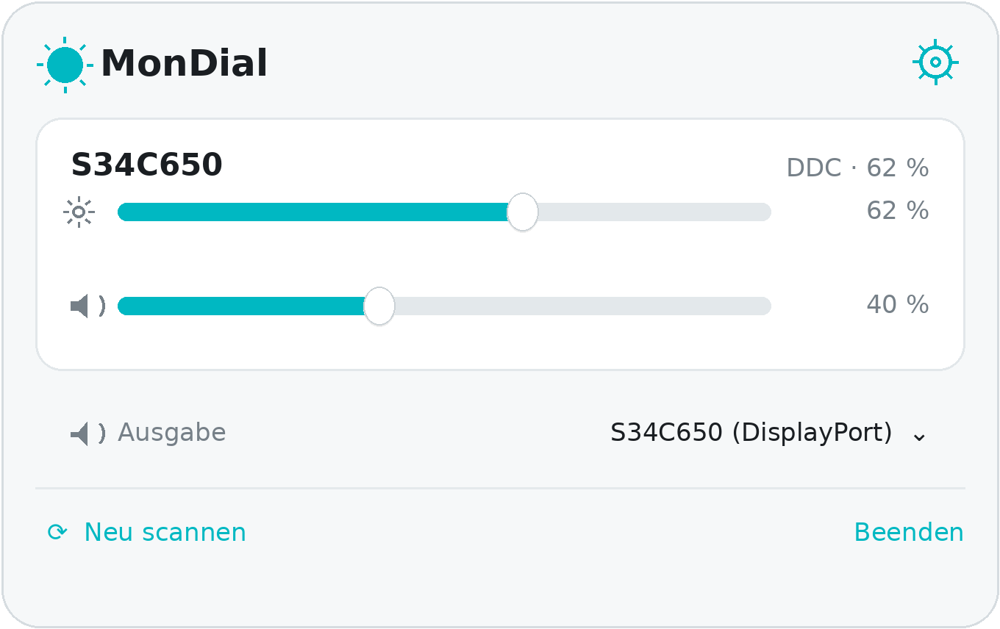
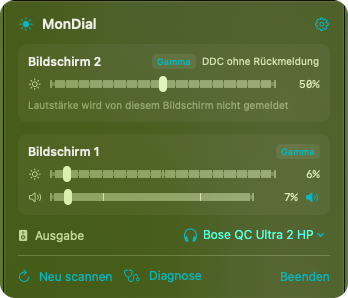

# MonDial

[](https://github.com/dropflow-ai/mondial/actions/workflows/build.yml)
[](LICENSE)


MonDial is a small macOS menu bar app that sets **brightness and volume of external displays** over DDC/CI — the I²C channel that travels inside DisplayPort, USB-C and HDMI cables. On a Mac mini there is no built-in display, so macOS never offers a brightness slider for a connected monitor and the volume keys act on a digital output that has no volume. MonDial talks to the panel directly: backlight for brightness, the monitor's own speakers for volume.



*Schematic of the menu bar panel. The real panel uses the system's translucent menu bar material and the icons of the connected displays.*

## Why another one?

Honestly: if you want features, use [MonitorControl](https://github.com/MonitorControl/MonitorControl) (brightness, contrast, volume, native OSD, sync across displays) or [BetterDisplay](https://github.com/waydabber/BetterDisplay) (HiDPI scaling, virtual displays, XDR brightness). Both are mature and well maintained.

MonDial exists because the DDC plumbing on Apple Silicon is surprisingly hard to read about and surprisingly easy to get wrong. This project is roughly 1,800 lines of Swift, builds with Swift Package Manager instead of an Xcode project, ships a matching CLI, and tries to be a compact, readable reference for:

- the private `IOAVService*` API on Apple Silicon and the `IOI2CInterface` API on Intel,
- the two competing reply conventions monitors use for DDC reads,
- the difference between chip address `0x37` (DisplayPort/USB-C) and `0xB7` (HDMI via the MCDP29xx controller),
- and what "the write succeeded but nothing happened" actually means.

## Features

- **Brightness, volume and mute** per display. Volume uses VCP `0x62`, mute `0x8D`, brightness `0x10`.
- **Apple Silicon and Intel.** `IOAVService` on arm64, `IOI2CInterface` on x86_64, selected at compile time.
- **Self-correcting transport.** If the first read fails, MonDial retries with the other reply format and the other chip address instead of giving up.
- **Write verification.** A DDC write that the I²C layer accepted but the panel ignored is detected by reading the value back; MonDial then falls back to gamma-table dimming so the slider still does something.
- **Audio output switcher.** Lists every output device of the Mac and changes the default one, so the monitor's speakers can be targeted without opening System Settings.
- **Global hotkeys.** `⌃⌥↑`/`⌃⌥↓` for brightness, `⌃⌥⇧↑`/`⌃⌥⇧↓` for volume, `⌃⌥M` to mute. Optional takeover of the real media keys (`F1`, `F2`, `F10`–`F12`), which needs the Accessibility permission.
- **Diagnostics.** `mondialctl doctor` and a diagnostic panel that reports transport, chip address, reply format, response times and a write/read-back test.

The interface is bilingual and follows the system language, German or English. Set `MONDIAL_LANG=en` (or `de`) to force one, for example while testing a translation; the CLI and the diagnostics copy honour the same variable.

## Install

Requires macOS 13 or newer. A prebuilt arm64 build is attached to the [releases](https://github.com/dropflow-ai/mondial/releases). The app is ad-hoc signed, not notarised, so the quarantine flag has to be removed once:

```bash
xattr -dr com.apple.quarantine /Applications/MonDial.app
```

Building from source needs only the Xcode command line tools, no Xcode project:

```bash
git clone https://github.com/dropflow-ai/mondial.git
cd mondial
./build.sh --install      # builds, copies to /Applications, links mondialctl, launches
```

`./build.sh` alone writes `dist/MonDial.app` and `dist/mondialctl`; `./build.sh --run` starts the app afterwards.

Replacing an installed build — quit, remove, unpack, clear the quarantine flag, print the version, relaunch — is what `tools/reinstall.sh` does:

```bash
./tools/reinstall.sh ~/Downloads/MonDial-app.zip
```

## Why the app is not notarised

MonDial ships ad-hoc signed (`codesign --sign -`). That is enough for the app to run, but macOS marks every downloaded file as quarantined, and Gatekeeper only waives that for binaries signed with an Apple **Developer ID** certificate *and* notarised by Apple. Notarisation means: a paid Apple Developer Program membership (99 USD per year), a Developer ID certificate, hardened runtime flags when signing, an upload to Apple's notary service and a stapled ticket attached to the bundle.

I skipped it deliberately. The project earns nothing, so the fee would buy nothing for the handful of people who build it themselves. More importantly: notarisation creates the impression of an Apple-vetted download, while the core of this app is an undocumented private API (`IOAVService*`) that Apple can change with any macOS release. Advertising a frictionless, officially blessed install on top of a private function would be misleading. The honest version is the one below — one command, once.

```bash
xattr -dr com.apple.quarantine /Applications/MonDial.app
```

Since macOS 15 the old Control-click → *Open* trick no longer bypasses Gatekeeper; the GUI route is System Settings → Privacy & Security → *Open Anyway*. If you build from source with `./build.sh --install`, no quarantine is involved at all: the binary is compiled locally and never carries the attribute.

If a notarised build ever becomes worthwhile — more users, or a Homebrew cask without `--no-quarantine` — the work is small: the CI already produces the bundle, so it needs a certificate secret, `--options runtime` in `build.sh` and a `notarytool` step in the workflow.

## Command line

```bash
mondialctl list                  # all displays with current brightness and volume
mondialctl doctor                # transport, chip address, response times, write test
mondialctl get brightness
mondialctl set brightness 40
mondialctl set volume 35 --display 2
mondialctl step brightness -6
mondialctl mute toggle
```

`mondialctl` is also copied into the app bundle, so it works without installing anything:
`/Applications/MonDial.app/Contents/Resources/mondialctl doctor`

## How it works

A DDC/CI exchange is a handful of bytes pushed to the monitor's I²C address `0x37` (or `0xB7` on the HDMI path) at data address `0x51`:

| Step | Bytes | Meaning |
|---|---|---|
| Set VCP feature | `84 03 <code> <hi> <lo> <chk>` | write a value |
| Get VCP feature | `82 01 <code> <chk>` | request current and maximum |
| Reply | `6E 88 02 00 <code> <type> <maxHi> <maxLo> <curHi> <curLo> <chk>` | 11-byte answer |

The awkward part is the reply: some panels expect the request checksum to include the `0x51` data address and answer at offset `0x51` with a 12-byte buffer, others expect the checksum without it and answer at offset `0` with 11 bytes. MonDial probes once, remembers what worked, and re-probes the other convention if a read fails.

Apple Silicon no longer exposes `IOI2CInterface`. DDC goes through the display coprocessor (`DCPAVServiceProxy`) using three private functions resolved with `dlsym`:

```swift
IOAVServiceCreateWithService(CFAllocator?, io_service_t) -> CFTypeRef?
IOAVServiceReadI2C (CFTypeRef, uint32 chip, uint32 offset, void *buf, uint32 len)
IOAVServiceWriteI2C(CFTypeRef, uint32 chip, uint32 offset, void *buf, uint32 len)
```

Displays are enumerated with `CGGetOnlineDisplayList`, matched to their `DCPAVServiceProxy` via `kCGDisplayIsPrimary`/`kCGDisplayIsMain` and the CoreDisplay info dictionary, and cached per `CGDirectDisplayID`.

## Compatibility and known limitations

**HDMI does not carry DDC on many Apple Silicon Macs.** The built-in HDMI port of the M1 family and the entry-level M2 mini accepts DDC packets at the I²C layer but never forwards them to the panel. MonitorControl documents the same restriction. Use USB-C/Thunderbolt or DisplayPort instead; MonDial detects the silent failure and falls back to gamma dimming, which looks like brightness control but saves no power and also dims the menu bar.

**Private API.** `IOAVService*` is undocumented. A macOS update can break it, and none of this can ship on the App Store. The Intel path uses `IOI2CInterface`, which has been deprecated for years.

**Some panels simply say no.** Monitors with a locked brightness control (active HDR, "Eye Saver", "Eco Saving", adaptive picture), KVM switches, hubs and capture devices can swallow DDC entirely. `mondialctl doctor` tells you which of the four test values still answer.

**Gamma dimming is not brightness.** When DDC fails, the panel's backlight stays where it is and the image is scaled down instead. MonDial reports this as „DDC wirkungslos – Software-Dimmung".



*A real panel with two monitors on a Mac mini. The upper one sits on the HDMI port, never answers a DDC request and is dimmed through the gamma table instead — the **Gamma** chip is highlighted. The lower one is connected over USB-C, reports brightness and volume, and its speakers are the selected output. Nothing here is a bug: the same setup produces exactly this display.*

**A second display on HDMI will never answer.** The Mac mini has exactly one HDMI port, and as noted above that path swallows DDC on Apple Silicon. If both monitors are meant to be controlled, put the second one on a USB-C/Thunderbolt port with a USB-C-to-DisplayPort cable — adapters that convert to HDMI in the cable tend to break DDC as well.

## How it compares

| | MonDial | MonitorControl | BetterDisplay |
|---|---|---|---|
| Brightness and volume over DDC | yes | yes | yes |
| Native OSD, display sync | no | yes | yes |
| DDC over problematic HDMI ports | no | no | yes |
| HiDPI scaling, virtual displays | no | no | yes |
| CLI with the same engine | yes | no (see `m1ddc`) | partial |
| Build system | Swift Package Manager | Xcode project | Xcode project |
| Size | ~1.8k lines | large | large |
| Price | free, MIT | free, GPL-3.0 | free + paid Pro |

## Diagnostics

```bash
mondialctl doctor
```

```
MonDial 1.1.2
System          macOS 15.1
Architecture    arm64 (Apple Silicon)
DDC backend     IOAVService (private, Apple Silicon)

[1] S34C650
    external · IOAVService, chip=0x37, read=data-address
    UUID 37D8832A-...
    Brightness    62 % (max 100)  [41 ms]
    Contrast      75 % (max 100)  [38 ms]
    Volume        40 % (max 100)  [44 ms]
    Mute          aus  [39 ms]
```

The app shows the same data in its diagnostics panel, with a copy button.

## Project layout

```
Sources/MonDialKit/     transport, VCP codes, display matching, preferences, gamma dimming
Sources/MonDialApp/     SwiftUI menu bar app, hotkeys, media keys, audio outputs, login item
Sources/mondialctl/     command line front end
Resources/Info.plist    bundle definition
build.sh                builds the .app bundle without Xcode
.github/workflows       macOS CI: build, smoke test, artifact
```

## Contributing and maintenance

Issues and pull requests are welcome, but this is a side project: there is no support contract and no release schedule. Realistic promises only — bug reports with a `mondialctl doctor` output get looked at first, and macOS betas are checked when I happen to run one. If you need guaranteed support for a fleet of Macs, BetterDisplay is the safer choice.

Open items: Homebrew cask, a hero screenshot taken on a single-display setup, notarised release build. Version history is in [CHANGELOG.md](CHANGELOG.md).

## License

MIT, see [LICENSE](LICENSE).

The DDC packet layout and the private symbol names are protocol and system facts; the implementation here was written from scratch after reading the public sources of `m1ddc` and MonitorControl for reference on which API to call. No code was copied from those projects — note that MonitorControl is GPL-3.0, so anything derived from it would have to stay GPL.

---

## Deutsch in Kürze

MonDial ist eine Menüleisten-App, die Helligkeit und Lautstärke externer Bildschirme über DDC/CI steuert – auch dort, wo macOS keinen Regler anbietet, etwa am Mac mini. Sie läuft auf Apple Silicon und Intel, bringt ein CLI (`mondialctl`) mit und erkennt selbst, wenn ein Monitor Schreibbefehle zwar annimmt, aber ignoriert (typisch für HDMI an Apple Silicon); dann wird auf Gamma-Dimmung ausgewichen.

Installation: Release-ZIP nach `/Programme` ziehen, einmal `xattr -dr com.apple.quarantine /Applications/MonDial.app`, fertig. Oder selbst bauen: `./build.sh --install`.

Die Oberfläche ist zweisprachig und folgt der Systemsprache (Deutsch oder Englisch). Für Helligkeit, Kontrast, OSD und Display-Synchronisierung ist [MonitorControl](https://github.com/MonitorControl/MonitorControl) die reifere Wahl; MonDial ist bewusst klein und als lesbare Referenz gedacht.
